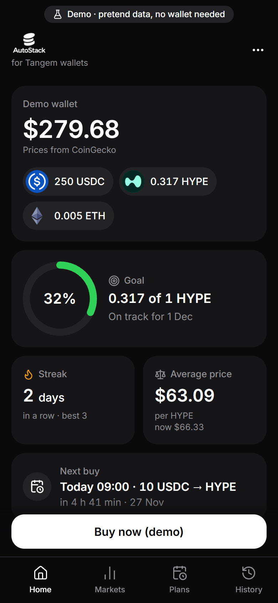
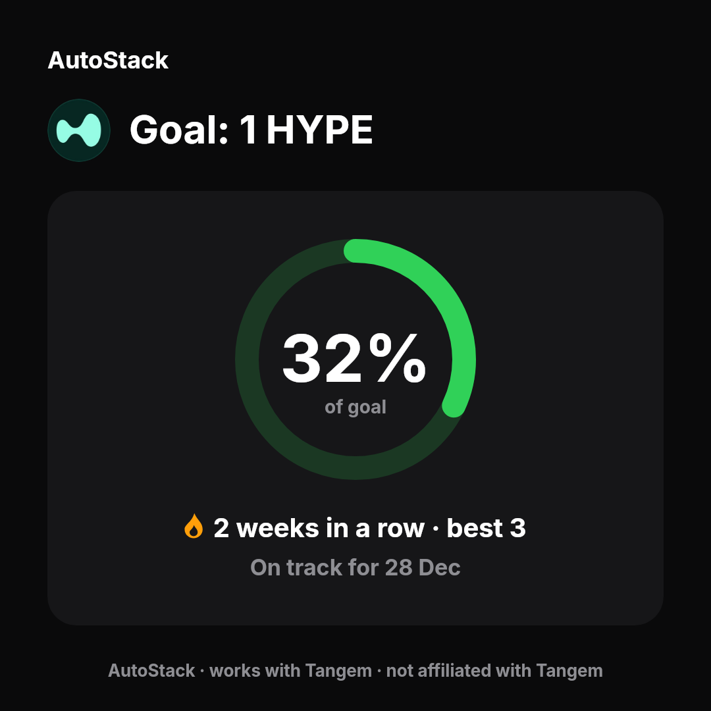

# AutoStack

AutoStack is a Telegram bot that buys crypto for you on a schedule from your Tangem wallet, for example
10 USDC of HYPE every day at 09:00. It's dollar-cost averaging (DCA): a fixed amount on a schedule,
so over time you pay about the average price.

When a buy is due, AutoStack gets Tangem's best price and prepares the buy in Tangem. You get a message
("Your buy is ready") and a Tangem notification; open Tangem and tap your card to approve.

> **Run at your own risk. Not financial advice. Start with small amounts. AutoStack never signs: you approve
> every buy in Tangem. Not affiliated with Tangem.**

AutoStack's alerts are information only.

## Try the demo

Open **https://t.me/AutoStackTangemBot/demo** in Telegram (or https://0xmigzy.github.io/autostackbot/ in a browser).
It's a Mini App with pretend data: no wallet, no sign-in, nothing is bought. It runs entirely in your browser,
even when the bot itself is offline. Source: [`demo-miniapp/`](demo-miniapp/).




## Setup

1. Install Node.js 20.12 or newer from <https://nodejs.org>, then get the code:

   ```
   git clone https://github.com/0xMigzy/autostackbot.git
   cd autostackbot
   ```

   (No git? On the GitHub page, click **Code → Download ZIP**, unzip it and open a terminal in that folder.)
   Each person runs their own copy, with their own bot, their own Tangem wallet and their own keys.
2. **Create your bot:** in Telegram, open [@BotFather](https://t.me/BotFather), send `/newbot`, pick a name
   (e.g. AutoStack) and a username ending in `bot`. BotFather replies with a token like `123456789:AA…`.
3. **Inline mode (optional, for posting share cards from any chat):** in @BotFather send `/setinline`,
   pick your bot and type a placeholder such as `Share my AutoStack card`.
4. **Get your user ID:** open [@userinfobot](https://t.me/userinfobot) and send any message; it replies with your numeric ID.
5. **Get a CoinGecko key:** create a free Demo API key at <https://www.coingecko.com/en/api/pricing>.
   AutoStack stays well inside the free plan (10,000 calls a month): prices are fetched in one batched call,
   cached for 5 minutes, and only for /portfolio, /markets, plan setup and the hourly price-dip check.
6. **Install and run setup:** in this folder, run:

   ```
   npm install
   npm run setup
   ```

   Setup asks for your bot token, your Telegram user ID, your CoinGecko key and your time zone
   (Europe/London unless you change it), checks them, and saves them in `.env`. Nothing is shown on screen.
   `.env` holds secrets: never share or commit it. Run `npm run setup` again anytime to change a value.
7. Open your bot in Telegram and press **Start**, so it is allowed to message you.
8. Start AutoStack:

   ```
   npm start
   ```

9. **QR login (first start only):** a page with a QR code opens in your browser. Scan it with the Tangem app
   on your phone to connect your wallet. AutoStack then sends you "🟢 AutoStack is online".

Keep the terminal open: plans only run while AutoStack is running. Ctrl+C stops it.
If the Tangem login expires, AutoStack tells you: restart AutoStack and scan the QR.

## Commands

| Command | What it does |
| --- | --- |
| `/start` | Welcome and main menu |
| `/portfolio` | Your wallet in dollars, per token and network |
| `/markets` | Coins you can buy with your USDC, with prices; search for more |
| `/dca` | Set up a new DCA plan: pick a coin, amount, schedule and goal |
| `/plans` | Your plans: progress, streak, next buy; buy now, edit, pause, restart or delete |
| `/history` | Your last buys, a summary per coin, CSV export, and Clear history |
| `/pause` | Pause or resume everything |
| `/settings` | Reminders, quiet hours, low USDC alert, amounts on share cards, clear history, start over |
| `/help` | How AutoStack works |

**Setting up a plan** happens in one message: amount, how often (daily, weekly, monthly, every X days), the day
(weekly/monthly), whether the first buy happens **now** or waits for the schedule, the time for the next buys
(now, 08:00, 12:00, 18:00, or any time you type, like 7.45 or 7pm), when to stop (never, after X buys, on a date,
or at a goal in coins or dollars) and which USDC to pay with. The summary shows the first buy, the schedule, about
how much you get each time and when you'll reach your goal. With **Buy now**, the first buy is prepared as soon as you
tap Start; it counts for the current day/week/month, so the schedule doesn't buy again in that same period.

**Clear history** (in /history or /settings): clear every coin or one coin, optionally after exporting a CSV.
Buys still waiting for approval are kept, your plans keep running, and the cleared coin's streak, average price and
goal progress start again. Your crypto in Tangem is not affected.

**Streaks** count the days, weeks or months in a row with a completed buy. Approving late in the period counts;
paused periods don't break a streak.

**Reminders:** a buy waiting for approval gets a reminder every 6 hours by default, never during quiet hours.
If the price changed a lot, tap "Get a fresh price".

**Alerts** (information only): not enough USDC the day before a buy; a coin 10% or more below your average buy
price; a cheaper way to pay when you hold USDC on another network.

**Share cards:** tap Share to get a 1080×1080 image of your goal and streak (no amounts unless you turn them on
in /settings). To post it from any chat, type `@YourBotName` and a space (with inline mode on). Examples are in `samples/`.

**Adding coins:** /markets or /dca → Search. AutoStack shows matches with their network and contract, and the CoinGecko page
so you can check it's the right coin before tapping Add. Coins are always identified by network and contract
address, never by symbol alone. They're saved in `coins.json`.

## Safety

- A buy is prepared in Tangem only once per scheduled period, or when you tap Buy now or Get a fresh price.
  It is never retried automatically. If preparing a buy fails, the plan pauses and AutoStack tells you.
- Nothing is prepared while a plan, or everything, is paused.
- At most 3 new buy requests per day, across all plans.
- A plan never gets a second scheduled buy while one is still waiting for approval.
- Everything is paid out to your own address in your Tangem wallet.
- AutoStack works only for your Telegram account. Anyone else who messages your bot gets one short reply a day
  pointing to the demo, and nothing more. Messages sent while it was offline are ignored.
- The bot token and API keys are replaced with `***` in logs and errors.

## License

MIT, see [LICENSE](LICENSE).

## Files

Your data stays in this folder: `plans.json` (plans and settings), `history.json` (every buy), `coins.json`
(coins you can buy), `prices.json` (price cache and API call count) and `cache/logos/` (coin logos).
None of these are committed to git.

## Development

- `npm test`: unit tests (schedules, forecasts, streaks, reminders, alerts, CoinGecko budget, share cards)
- `npm run samples`: regenerates the sample share cards in `samples/`
- `npm run inspect`: saves the Tangem MCP tool schemas to `tangem-schemas.json`
- `npm run brand`: exports the bot picture (`autostack-avatar-512.png`) and the Mini App photo (`autostack-app-640x360.png`)
  into `demo-miniapp/public/brand/` from the brand originals
- `demo-miniapp/`: the demo Mini App (React + Vite), see its own README
