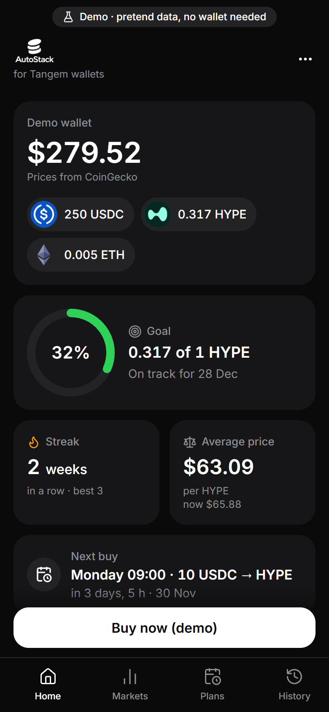
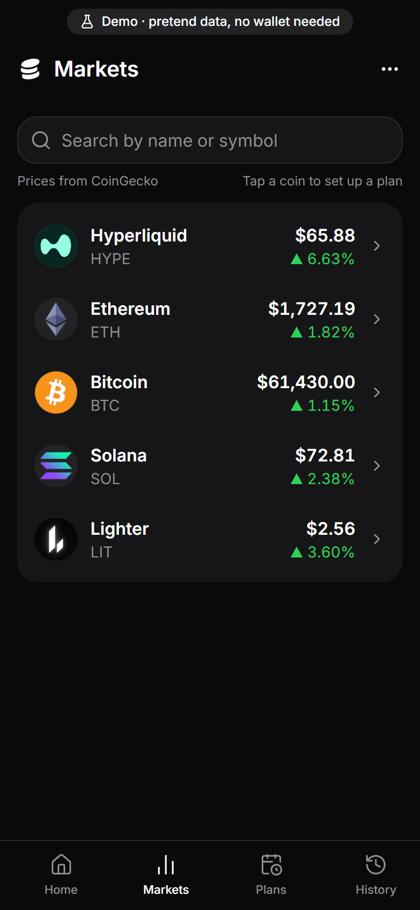
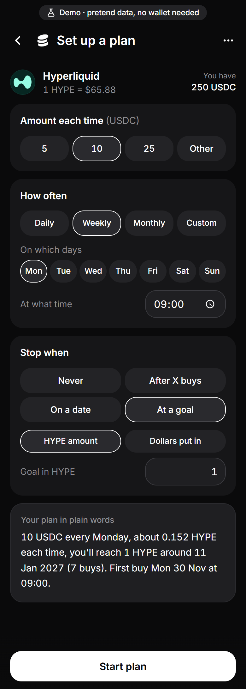
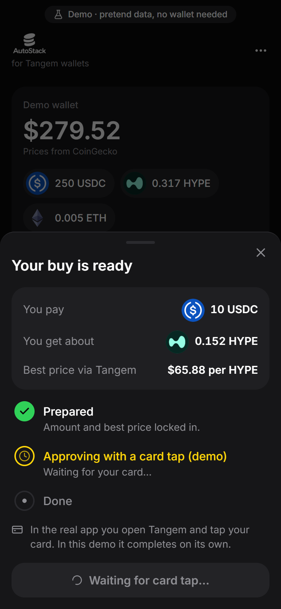
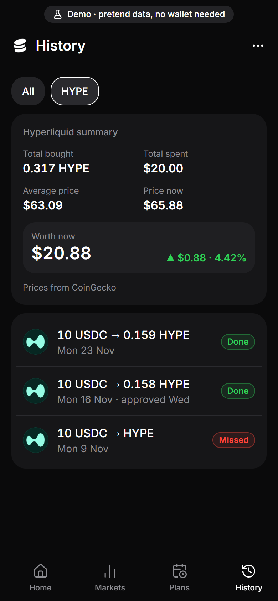

# AutoStack demo Mini App

A static demo of AutoStack, the Telegram bot for scheduled crypto buys from a Tangem wallet. It opens
inside Telegram as a Mini App (or in any browser) and runs entirely in the browser with pretend
data: a demo wallet, a HYPE plan, buy history, a pretend buy flow. It never connects to a wallet or to
an AutoStack server. The only network calls are one CoinGecko price request per visit and the coin
logo images it returns (with sample prices and letter logos as a fallback).

Live: https://0xmigzy.github.io/autostackbot/

AutoStack works with Tangem and is not affiliated with Tangem.

| Home                          | Markets                             | Set up a plan                           | Buy                         | History                             |
| ----------------------------- | ----------------------------------- | --------------------------------------- | --------------------------- | ----------------------------------- |
|  |  |  |  |  |

## Run it

Requires Node 22.12+.

```sh
npm install
npm run dev       # http://localhost:5173/
npm run build     # static site in dist/, served under /autostackbot/
npm run preview   # serves dist/ at http://localhost:4173/autostackbot/
```

Other scripts: `npm run lint`, `npm run typecheck`, `npm run format`.

The demo state is saved in `localStorage`; use **Reset demo** in the ⋯ menu to start over.

## How it is built

React, Vite, TypeScript, Tailwind CSS and shadcn/ui components (`src/components/ui`), lucide icons,
Inter (self-hosted). State lives in small pure modules: `src/lib/demo-store.ts` (reducer and
persistence), `src/lib/schedule.ts` (next buys and countdowns), `src/lib/plan-summary.ts`
(plain-words forecasts) and `src/lib/prices.ts` (the CoinGecko request).

Inside Telegram it uses the official WebApp SDK: `ready()`/`expand()`, the colour scheme for
light/dark, the MainButton for each screen's main action, the BackButton for the plan setup and buy
sheet, and haptic feedback. In a normal browser the same actions appear as in-page buttons.
